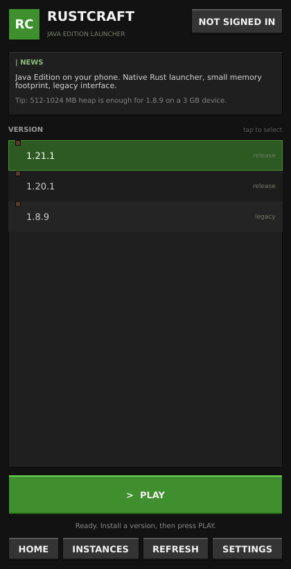

# RustCraft Launcher

لانشر **Minecraft: Java Edition** للأندرويد مكتوب بلغة **Rust**، بواجهة تُحاكي شكل
لانشر PojavLauncher القديم، ومصمّم أساساً للأجهزة الضعيفة (2–4 GB RAM).

> **ملاحظة صريحة قبل أي شي**
>
> Rust تقدر تستبدل *طبقة اللانشر* بالكامل: الواجهة، تنزيل الملفات، تسجيل الدخول،
> تركيب المودات، بناء أوامر التشغيل، إدارة الذاكرة. لكن **ما تقدر تستبدل الـ JVM
> ولا طبقة ترجمة الرسوميات** — ماين كرافت جافا ملفات `.class` تحتاج JVM، واللعبة
> تنادي OpenGL بينما أندرويد يوفّر OpenGL ES. لذلك المشروع:
>
> - **Rust** = الواجهة + المحرّك + كل منطق اللانشر (هذا المستودع).
> - **OpenJDK مصغّر (jlink)** + **LWJGL نسخة أندرويد** + **مترجم GL** = يعاد
>   استخدامها من مشاريع مفتوحة المصدر موجودة (PojavLauncher وgl4es/Zink/ANGLE).
>
> النتيجة: استهلاك ذاكرة أقل من Pojav لأنه ما فيه واجهة Java ولا WebView، لكن
> **JVM نفسه يبقى أكبر بند في الاستهلاك** (حوالي 120–200 MB قبل أي `-Xmx`).

---

## الحالة الحالية

| الطبقة | الحالة |
|---|---|
| نواة Rust: manifest، rules، classpath، natives، تنزيلات، SHA-1 | ✅ مكتوبة وقابلة للاختبار |
| تسجيل دخول Microsoft (device code → XBL → XSTS → Minecraft) | ✅ مكتوب |
| CLI للتجربة على الكمبيوتر (install / login / plan / launch) | ✅ |
| واجهة Slint بشكل اللانشر القديم | ✅ هيكل كامل + ربط الأزرار |
| ربط JVM على أندرويد (JNI + السطح + LWJGL) | ⛔ المرحلة M3 (غير منفّذة هنا) |
| Fabric/Forge/Modrinth، شيدرز، إعدادات متقدمة | ⛔ المراحل M5–M6 |

المستودع الحالي = **تصميم كامل + نواة حقيقية + واجهة**. مو لعبة تشتغل من أول
`cargo build`؛ الجزء الصعب (تشغيل JVM داخل تطبيق NativeActivity) موصوف بالتفصيل
في [`docs/ARCHITECTURE.md`](docs/ARCHITECTURE.md) ومقسّم لمراحل في
[`docs/ROADMAP.md`](docs/ROADMAP.md).

### تم التحقق فعلياً في هذه البيئة

- `cargo test -p rustcraft-core`: **8/8 نجحت**.
- `cargo check` لكل الـ workspace.
- تنزيل وتثبيت **1.8.9** كامل: 768 ملف / 131.4 MB (مع الـ assets والـ natives).
- `rustcraft plan 1.8.9` يبني classpath صحيح، و`launch` يصل إلى
  `net.minecraft.client.main.Main` (الفشل بعدها كان بسبب غياب AWT في حاوية
  الاختبار، وليس اللانشر).



---

## هيكل المشروع

```
Cargo.toml               workspace
crates/core/             rustcraft-core  ← كل منطق اللانشر (بدون UI)
  src/manifest.rs        قراءة version JSON + دمج inheritsFrom (Fabric/Forge)
  src/rules.rs           قواعد os/features (أندرويد = linux)
  src/install.rs         تنزيل النسخة، المكتبات، الـ assets، فك الـ natives
  src/download.rs        تنزيل متوازي، تحقق SHA-1، بلا تحميل كامل بالذاكرة
  src/auth.rs            Microsoft device-code + Xbox + Minecraft Services
  src/launch.rs          بناء أمر java الكامل + placeholders
  src/session.rs         حفظ/قراءة الحساب (0600)
crates/cli/              تجربة النواة على الكمبيوتر
crates/ui/               Slint UI (نفس الواجهة للكمبيوتر والأندرويد)
  ui/app.slint           الشكل القديم: لوحات داكنة، أزرار بارزة، أخضر واحد
android/                 Gradle module + AndroidManifest (NativeActivity)
docs/                    التصميم، الذاكرة، الواجهة، خريطة الطريق
```

---

## تشغيل النواة على الكمبيوتر (أسرع طريق للتأكد إن كل شي سليم)

المتطلبات: Rust 1.80+، و Java 17 أو 21 على `PATH` (أو `JAVA_HOME`).

```bash
cargo test -p rustcraft-core          # اختبارات rules/classpath/placeholders
cargo run -p rustcraft-cli -- list
cargo run -p rustcraft-cli -- install 1.20.1
cargo run -p rustcraft-cli -- login --offline Steve      # تجربة بدون حساب
# أو حساب أصلي (يحتاج Azure client id خاص فيك):
cargo run -p rustcraft-cli -- login --client-id <YOUR_AZURE_CLIENT_ID>
cargo run -p rustcraft-cli -- plan 1.20.1                # يعرض أمر java بدون تشغيل
cargo run -p rustcraft-cli -- launch 1.20.1 --ram 2048
```

> تسجيل الدخول الحقيقي يحتاج تسجيل تطبيق Azure مجاني (Public client /
> "Mobile and desktop applications") واستخدام الـ client id الخاص فيك.
> لا تضع client secret داخل تطبيق موبايل.

تشغيل الواجهة على الكمبيوتر:

```bash
cargo run -p rustcraft-ui
```

> ملاحظة: ملفات `Cargo.lock` غير موجودة هنا لأن بيئة التوليد ما فيها Rust
> ولا اتصال بالـ crates.io. أول `cargo build` عندك بينشئها ويثبّت الإصدارات.

---

## بناء تطبيق أندرويد

المتطلبات: Android Studio (AGP 8.7)، NDK 26+، `cargo-ndk`، target `aarch64-linux-android`.

```bash
rustup target add aarch64-linux-android armv7-linux-androideabi
cargo install cargo-ndk

cargo ndk -t arm64-v8a -t armeabi-v7a \
  -o android/app/src/main/jniLibs \
  build -p rustcraft-ui --release --no-default-features --features android
```

بعدها افتح مجلد `android/` في Android Studio واعمل Run. التفاصيل والملاحظات في
[`android/README.md`](android/README.md).

---

## استهلاك الذاكرة المستهدف (جهاز 3 GB)

| البند | الميزانية |
|---|---|
| Rust core + Slint (واجهة) | 15–25 MB |
| OpenJDK مصغّر بـ jlink | 20–35 MB (.so محمّل) + metaspace |
| JVM heap (1.8.9) | 384–512 MB (`-Xmx`) |
| LWJGL + مترجم GL + اللعبة | 80–120 MB |
| **الإجمالي المتوقع** | **≈ 350–450 MB** |

التفاصيل وطرق التوفير في [`docs/MEMORY.md`](docs/MEMORY.md).
إعدادات جهازك (Galaxy M33 5G) بالتفصيل في
[`docs/DEVICE-M33.md`](docs/DEVICE-M33.md).

---

## الترخيص والقانون

- الكود هنا: **GPL-3.0-or-later**، لأن المرحلة M3 تعيد استخدام LWJGL fork
  وطبقات من PojavLauncher (GPLv3).
- لا تُوزّع ملفات اللعبة أو الـ assets أو مكتبات Mojang مع التطبيق؛ اللانشر
  ينزّلها من سيرفرات Mojang بعد أن يسجّل المستخدم دخوله بحسابه.
- المستخدم لازم يملك نسخة أصلية من Minecraft: Java Edition.
